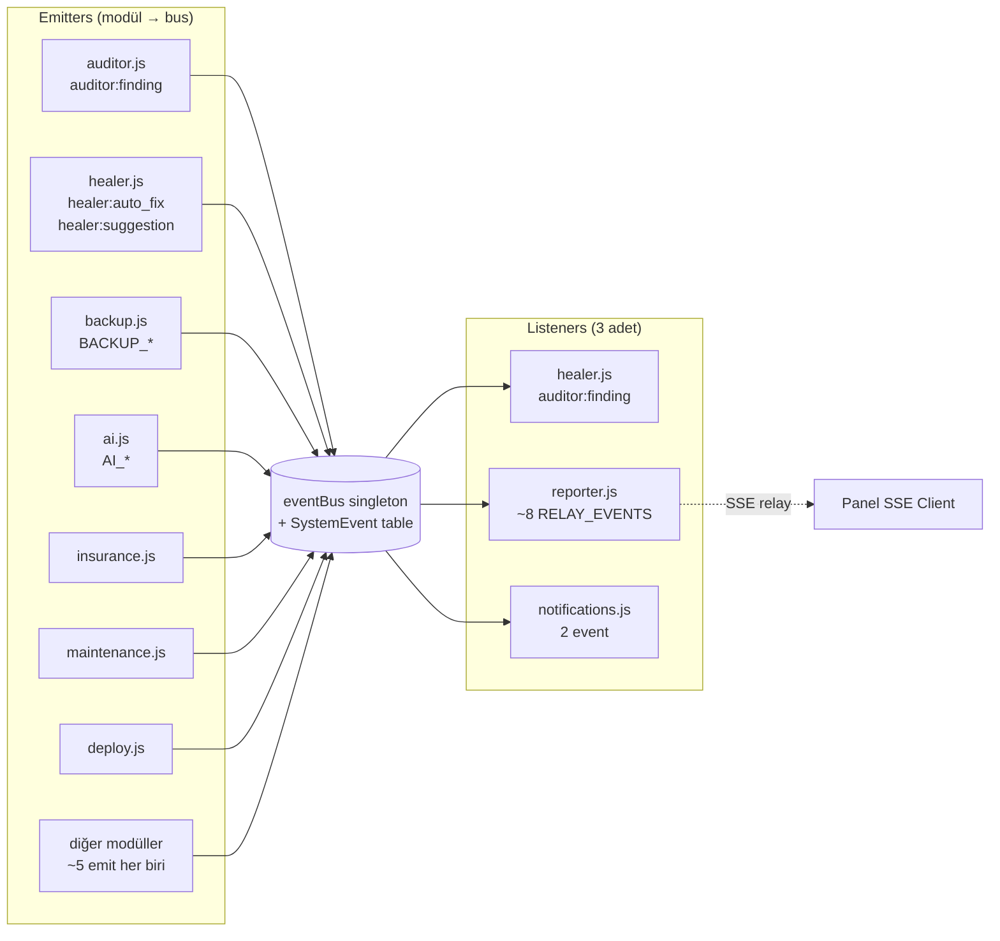
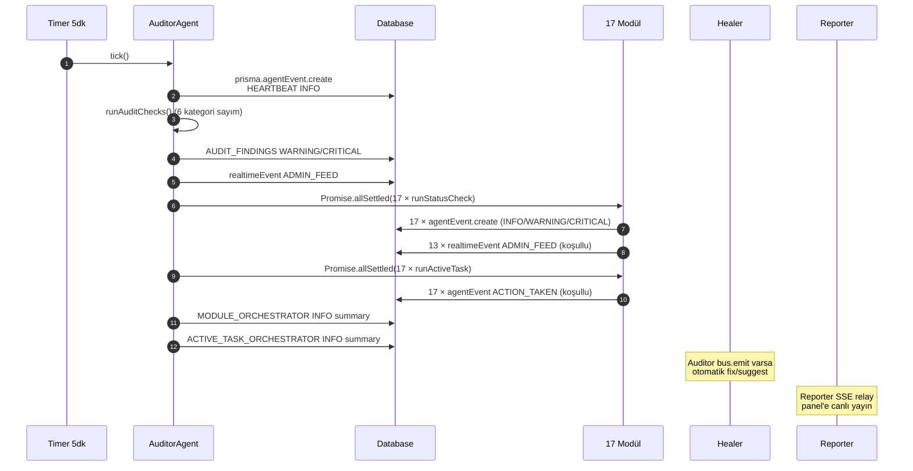

# TUR #108 — DEPENDENCY GRAPH (Görsel Mimari Diagram)

**Tarih:** 10 Mayıs 2026
**Tip:** Pure keşif — kod gerçeğine dayalı Mermaid diagram
**Anayasa:** v1.26.0

---

## 🗺️ Tam OS Mimarisi Görselleştirme

```mermaid
graph TB
    subgraph "Server Boot (boot.js — 11 step)"
        BOOT[runBoot]
        BOOT --> CHECK_DB[checkDatabase ✅]
        BOOT --> CHECK_SB[checkSupabaseStorage ✅]
        BOOT --> CHECK_ANT[checkAnthropicAPI ✅]
        BOOT --> CHECK_SSE[initSSEEndpoints ✅]
        BOOT -.-> CHECK_OR[Oracle/pg-boss/UYAP/SBM/VERBIS<br/>OPTIONAL/STUB]
    end

    subgraph "Core Infrastructure (src/os/)"
        BUS[eventBus<br/>EventEmitter + DB persist]
        IDEM[idempotency<br/>1h cleanup]
        REC[reconciler<br/>5dk policy tick<br/>POLICY_HANDLERS map]
        SUP[supervisor<br/>systemd-style restart]
    end

    subgraph "Agents (src/agents/ — 3 agent)"
        AUD[Auditor 5dk]
        HEAL[Healer 10dk]
        REP[Reporter 1h]
        SCH[runner.js scheduler<br/>EmailDigest 09:00 + Pulse Pazar 23:59]
    end

    subgraph "OS Modules (src/os/modules/ — 17 modül)"
        AI[ai 624 satır]
        ANALYZER[analyzer 615]
        APPEAR[appearance 237]
        BACKUP[backup 724]
        COMP[compliance 689]
        COST[costGuard 626]
        DEP[deploy 691]
        INS[insurance 284]
        MAINT[maintenance 536]
        MIMAR[mimarHatasi 139]
        NAV[navigation 360]
        NOTIF[notifications 648]
        PERF[performance 541]
        PULSE[pulse 598]
        REC2[recovery 472]
        SEC[security 689]
        UYAP[uyapControl 619]
    end

    subgraph "HAL Adapters (src/os/adapters/ — 9 adapter type)"
        AD_ANT[anthropic.js 196]
        AD_REND[render.js 146]
        AD_VERC[vercel.js]
        AD_SUPA[supabase.js]
        AD_ORAC[oracle.js 206 STUB]
        AD_KVKK[kvkk.js 149]
        AD_UYAP[uyap.js STUB]
        AD_SBM[sbm.js 94 STUB]
        AD_EIMZA[eimza.js 87 STUB]
    end

    subgraph "DB Tables (canlı yazım)"
        T_AE[(AgentEvent<br/>~7100/gün)]
        T_RE[(RealtimeEvent<br/>ADMIN_FEED + per-user)]
        T_AL[(ActivityLog<br/>KVKK audit)]
        T_LEAD[(Lead)]
        T_DOC[(Document)]
        T_USER[(User)]
        T_SESSION[(Session)]
    end

    subgraph "External APIs (4 modül bağımlı)"
        EXT_ANT[api.anthropic.com<br/>AI_FEATURES_ENABLED flag]
        EXT_SUPA[api.supabase.com<br/>Management API]
        EXT_REND[api.render.com]
        EXT_VERC[api.vercel.com]
    end

    BOOT --> BUS
    BOOT --> IDEM
    BOOT --> REC
    BOOT --> SUP

    %% Auditor → 17 modül (5 dk tick)
    AUD ==>|runAllModules<br/>runAllActiveTasks| AI
    AUD ==> ANALYZER
    AUD ==> APPEAR
    AUD ==> BACKUP
    AUD ==> COMP
    AUD ==> COST
    AUD ==> DEP
    AUD ==> INS
    AUD ==> MAINT
    AUD ==> MIMAR
    AUD ==> NAV
    AUD ==> NOTIF
    AUD ==> PERF
    AUD ==> PULSE
    AUD ==> REC2
    AUD ==> SEC
    AUD ==> UYAP

    %% Modül → DB
    AI --> T_AE
    AI --> T_RE
    AI --> T_DOC
    ANALYZER --> T_AE
    ANALYZER --> T_RE
    ANALYZER --> T_DOC
    APPEAR --> T_AE
    APPEAR --> T_USER
    BACKUP --> T_AE
    BACKUP --> T_RE
    COMP --> T_AE
    COMP --> T_RE
    COMP --> T_AL
    COST --> T_AE
    COST --> T_RE
    COST --> T_DOC
    DEP --> T_AE
    DEP --> T_RE
    INS --> T_AE
    INS --> T_RE
    INS --> T_LEAD
    MAINT --> T_AE
    MAINT --> T_RE
    MAINT --> T_DOC
    MAINT --> T_SESSION
    MIMAR --> T_AE
    MIMAR --> T_RE
    MIMAR --> T_AL
    NAV --> T_AE
    NAV --> T_RE
    NAV --> T_LEAD
    NAV --> T_USER
    NOTIF --> T_AE
    NOTIF --> T_AL
    PERF --> T_AE
    PULSE --> T_AE
    PULSE --> T_RE
    PULSE --> T_LEAD
    PULSE --> T_DOC
    REC2 --> T_AE
    REC2 --> T_RE
    REC2 --> T_DOC
    REC2 --> T_LEAD
    SEC --> T_AE
    SEC --> T_RE
    SEC --> T_AL
    SEC --> T_USER
    UYAP --> T_AE

    %% External API
    AI -.->|fetch| EXT_ANT
    BACKUP -.->|fetch| EXT_SUPA
    DEP -.->|fetch| EXT_REND
    DEP -.->|fetch| EXT_VERC

    %% EventBus subscribers
    AUD -->|emit auditor:finding| HEAL
    HEAL -->|emit healer:auto_fix| REP
    HEAL -->|emit healer:suggestion| REP

    %% Service-modül 5 entegrasyon
    SVC_ADMIN[admin.os.controller] -.->|status read| AI
    SVC_LEAD[lead.controller] -.->|kvkk audit| AD_KVKK
    SVC_DOC[document.controller] -.->|kvkk audit| AD_KVKK
    SVC_SSE[os.events.routes] -.->|addClient| REP
    SCH -.->|weeklyRunner| PULSE

    %% Auditor → ADMIN_FEED
    AUD --> T_RE

    style BOOT fill:#fef3c7,stroke:#f59e0b
    style AUD fill:#dbeafe,stroke:#3b82f6
    style HEAL fill:#dbeafe,stroke:#3b82f6
    style REP fill:#dbeafe,stroke:#3b82f6
    style MIMAR fill:#fee2e2,stroke:#dc2626
    style EXT_ANT fill:#fef3c7
    style EXT_SUPA fill:#fef3c7
    style EXT_REND fill:#fef3c7
    style EXT_VERC fill:#fef3c7
```



---

## 🔍 EventBus Trafik Görselleştirme



**Bulgu:** ~46 emit, **3 listener**. Çoğu event "kimseye düşmüyor" (sadece SystemEvent tablosuna persist).

---

## 📡 ADMIN_FEED RealtimeEvent Pipeline

```mermaid
graph TD
    subgraph "ADMIN_FEED Yazıcılar (13 modül + 3 ek nokta)"
        W_AI[ai.js KRITIK]
        W_ANL[analyzer.js BACKLOG/STUCK]
        W_BAK[backup.js OVERDUE]
        W_COMP[compliance.js KVKK_25G]
        W_COST[costGuard.js BUDGET_EXCEEDED]
        W_DEP[deploy.js FAILED]
        W_INS[insurance.js UNASSIGNED]
        W_MIM[mimarHatasi.js HEALTH_CRITICAL]
        W_NAV[navigation.js REBALANCE]
        W_PUL[pulse.js ANOMALY]
        W_REC[recovery.js LEAD_STUCK_7D]
        W_SEC[security.js ADOPTION_LOW]
        W_AUD[auditor.agent.js AUDITOR_FINDINGS]
        W_AUTH[auth.controller LAWYER/REP_REGISTRATION]
        W_REP[reporter.agent.js DAILY_DIGEST]
    end

    RT[(RealtimeEvent<br/>channel=ADMIN_FEED)]
    SSE[/api/realtime/notifications<br/>SSE endpoint]
    PANEL[ADMIN Dashboard<br/>useRealtimeFeed hook]

    W_AI --> RT
    W_ANL --> RT
    W_BAK --> RT
    W_COMP --> RT
    W_COST --> RT
    W_DEP --> RT
    W_INS --> RT
    W_MIM --> RT
    W_NAV --> RT
    W_PUL --> RT
    W_REC --> RT
    W_SEC --> RT
    W_AUD --> RT
    W_AUTH --> RT
    W_REP --> RT

    RT --> SSE --> PANEL
```

---

## 🚦 Production Tick Akışı (5 dk Auditor cycle)



---

## 📊 Sayısal Özet

| Metrik | Değer |
|---|---|
| OS modülü sayısı | 17 |
| Agent sayısı | 3 (Auditor + Healer + Reporter) |
| HAL Adapter sayısı | 9 (4 production-ready + 5 STUB/THIN) |
| Boot step sayısı | 12 (4 critical + 8 optional/stub) |
| Modül-modül direct import | **0** |
| Modül → bus.emit toplam | ~46 |
| Modül ← bus.on listener | **3** (healer, reporter, notifications) |
| ADMIN_FEED yazıcı modül | 13/17 + 3 ek nokta |
| External API bağımlı modül | 4/17 |
| Service-modül entegrasyon noktası | 5 |
| Production AgentEvent / saat | ~293 |
| Production AgentEvent / 24h | ~7102 |
| Production'da görünür modül (`/api/agents-health`) | **16/17** ⚠️ |

---

## 🔴 Görselleştirilmiş 3 Sapma (Mimar Hatası 50 emsali)

### Sapma 1 — mimarHatasi modülü production endpoint'inde eksik

```
Auditor.runAllModules()        → [17 modül] ✅ (mimarHatasi DAHİL)
Auditor.runAllActiveTasks()    → [17 modül] ✅ (mimarHatasi DAHİL)
admin.os.controller status()   → [16 modül] ❌ (mimarHatasi YOK)
agent.routes /agents-health    → [16 modül] ❌ (mimarHatasi YOK)
src/os/registry.js OS_MODULES  → [17 modül] ✅ (mimarHatasi DAHİL)
```

**Sonuç:** Modül çalışıyor, AgentEvent yazıyor, ama 2 endpoint görmezden geliyor. CEO `/dashboard/sistem-durumu` UI'da mimarHatasi modülünü göremez. Madde 30.10 (16 Modül Otonom Disiplini) kuralı 17 modül için yenilenmemiş.

### Sapma 2 — Module-module communication varsayımı

```
Sohbet mimarı varsayımı:    A → B → C zinciri (modüller birbirini tetikler)
Gerçek kod:                 17 modül izole, 3 listener (healer/reporter/notifications)
```

**Sonuç:** Yeni modül önerisi "X bilgisini Y modülüne aktarır" varsayımı yapılırsa **mimari değişiklik gerekir** (eventBus listener eklenmesi). Mevcut yapıda otomatik akış YOK.

### Sapma 3 — Reconciler altyapı vs. gerçek kullanım

```
src/os/reconciler.js               → POLICY_HANDLERS map (boş)
modüller registerPolicyHandler()   → ~50 kayıt var
runReconcileTick()                 → 5 dk'da çalışıyor
Drift düzeltmesi gerçekten oluyor mu? → HAYIR (handler implementations TODO)
```

**Sonuç:** Kubernetes-style desired vs actual reconciliation iskelet hazır ama gerçek policy handler implementations yok. "Drift detection" şu an sadece **theoretical** (kod yorumlarına göre TODO).

---

— TUR #108 DEPENDENCY GRAPH TAMAM
— Mimar Hatası 50 düzeltme — kod gerçeği görselleştirme
